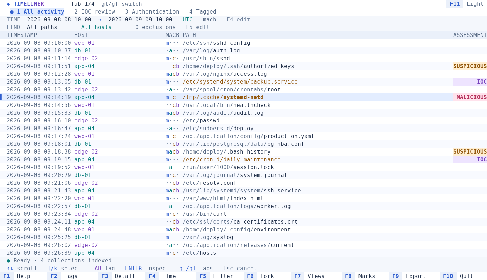
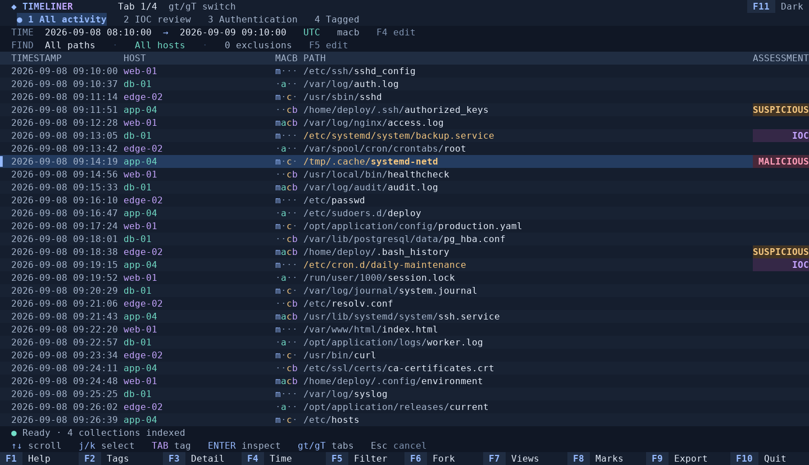

# Timeliner TUI

A terminal workbench for investigating forensic bodyfile timelines. Open bodyfiles
or extracted UAC collections, browse a merged timeline, assess records, and export
the original evidence records with host and annotation metadata.

This is a separate Rust application. It carries over Timeliner's UTC time
semantics, MACB grouping, and escaped-field handling. Records retain their source
identity, including duplicates on the same host or across different hosts.

## Run with Nix

```sh
# One bodyfile
nix run path:. -- timeline.body

# Multiple extracted UAC directories or bodyfiles
nix run path:. -- /cases/server-a /cases/server-b/bodyfile/bodyfile.txt

# Put the index on a disk with sufficient free space
nix run path:. -- --workspace /analysis/case-one \
  --ioc-file ~/ioc.filenames.yaml /cases/server-a /cases/server-b

# Resume an investigation without supplying its sources again
nix run path:. -- --workspace /analysis/case-one

# Build the index without opening a terminal interface
nix run path:. -- --index-only --workspace /analysis/case-one timeline.body
```

`path:.` also works before new files have been added to Git. After committing the
project, `nix run .` works too. Flake outputs support `x86_64-linux` and
`aarch64-linux`; each platform needs a compatible builder.

The initial import indexes the complete input and displays progress. Reopening
reuses that index. Source bodyfiles remain external and read-only: the workspace
does **not** copy them.

If an import is interrupted, resuming the workspace restarts that incomplete
source before enabling browsing. Already completed sources and their annotations
are retained.

Without `--workspace`, the application chooses a stable directory under
`$XDG_DATA_HOME/timeliner-tui`, falling back to
`~/.local/share/timeliner-tui`. Tabs, locations, tags, bookmarks, and applied IOC
rules are saved automatically. Only one application may open a workspace at a
time.

## Appearance

The interface uses 24-bit RGB colors with coordinated light and dark palettes.
Light is the default. Press **F11** to switch themes, including inside dialogs;
the choice is saved with the workspace. Override it at launch with
`--theme light` or `--theme dark`.

Hosts have stable accent colors, MACB flags have distinct colors, and assessment
badges use amber, violet, and rose. Subtle row shading, an accent selection marker,
and explicit foreground/background pairs keep the timeline readable. Dialogs
use rounded borders, focused input fields, and a separate surface color.
No special icon font is required.

Previews below use synthetic records rendered by the actual UI:





## Navigation and assessment

The timeline shows timestamp, hostname, MACB flags, pathname, and a tag column at
the right edge. Amber paths identify IOC rule matches; the tag column shows the
current assessment. ENTER opens the full pathname, all 11 fields, source line and
byte offset, original record, and matching rules.

| Key | Action |
| --- | --- |
| ↑ / ↓ | Scroll one row underneath a fixed highlight |
| j / k | Move the highlight within the visible screen |
| Page Up / Page Down | Scroll a screen |
| gg / G | Jump to the first / last matching event |
| TAB | Cycle untagged → SUSPICIOUS → IOC → MALICIOUS → untagged |
| ENTER / F3 | Record details |
| F1 | Help |
| F2 | Set/clear a tag, restore automatic assessment, or reload IOC rules |
| F4 | Begin/end timeframe and timezone |
| F5 / `/` | Path, host, timestamp-type, and bogus-time filters |
| F6 | Fork the current view |
| F7 | Global smart tabs; rename or close a tab |
| 1–9 (with Shift if needed) | Select tab by number |
| gt / gT | Next / previous tab |
| F8 | Bookmark list |
| F9 | Export |
| F10 / Ctrl+C | Quit |
| F11 | Switch light/dark theme |
| x / X | Exclude the selected pathname / directory subtree |
| u | Remove the most recent exclusion |
| D | Malformed-record diagnostics |
| Escape | Close a dialog or cancel pending work |

TAB tags the **whole original bodyfile record**. Its other timestamp events carry
the same assessment in every tab. TAB switches fields when a dialog has focus.
Forms support Ctrl+U to clear a field. In the filter editor, F2 focuses a new
exclusion and Ctrl+D removes the focused exclusion; Enter applies the changes.

New workspaces start with Timeline and IOC tabs. The IOC tab shows records whose
current assessment is IOC across the whole investigation. Saved workspaces
restore their existing tabs.

Forking copies the current filters and location. The new tab is independent.
Smart tabs—All tagged, SUSPICIOUS, IOC, and MALICIOUS—start across the whole
investigation and update when tags change.

The header shows numbered tabs, marks the active tab with `●`, and displays its
position (for example, `Tab 2/4`). Use `1`–`9` to select a tab directly or `gt`/`gT`
to switch in order. When titles exceed the screen width, `<` and `>` indicate
hidden tabs; the active tab stays visible.

Use `ma` to set bookmark `a`, `'a` to jump to it, and `''` to return after a jump.
Bookmarked events show a `●` in the left margin, including on the selected row.
Marks `a` through `z` persist. If the current filters hide a bookmarked event, a
new unfiltered tab reveals it. In F8, press `d` followed by a letter to delete a
mark. Text registers and yank commands are not implemented.

## Time and path filters

UTC is the default timezone. `--tz America/New_York` changes display and boundary
interpretation. F4 changes the timeframe interactively. Blank boundaries are
unbounded; a date-only begin means midnight and a date-only end includes the
entire day. Ambiguous or nonexistent local times are rejected.

ENTER/F3 displays all four record timestamps in ISO 8601 format with the selected
timezone's offset, for example `2026-09-16T12:34:56+00:00`. All formatted field
values share one column. The original bodyfile line remains available below the
formatted details.

```sh
nix run path:. -- --after 2026-09-01 --before 2026-09-03 \
  --tz UTC timeline.body
```

F5 combines an optional inclusion regex, any number of exclusion regexes, host
selection, and MACB timestamp types. Exclusions are ORed; the other conditions
are combined with AND. Invalid regexes leave the working view intact. The syntax
is Rust regex syntax, without lookaround or backreferences.

Nonpositive timestamps are hidden by default. Enable them in F5 when needed.
Exclusions apply as pages are fetched from your current position, within the
selected timeframe. Adding or removing one does not build a full filtered
database. Use `x` or `X` to exclude a pathname or directory, `u` to undo the most
recent exclusion, or F5 to edit individual patterns.

Searches run in the background and Escape cancels them. A very restrictive
filter can still require searching much of the selected timeframe to fill a
page or establish that there are no matches. Tag views reuse a separate tag
index; changing path or host filters does not rebuild it.

## UAC and hostnames

Passing an extracted UAC directory selects its `bodyfile/bodyfile.txt`.
Hostname discovery checks collected hostname command output, `uac.log`, and
collected `etc/hostname` files. The collection directory or bodyfile filename is
the fallback.

```sh
# Repeat --host for explicit input-specific labels
nix run path:. -- --host /cases/server-a web-01 /cases/server-a

# Legacy bodyfiles with hostnames stored in their first field
nix run path:. -- --host-from-md5 combined.body
```

An explicit host override takes precedence over legacy mode. Legacy mode falls
back to the source label for empty, `0`, or `-` first fields. Neither mode changes
the original field. Shell globs work when expanded by the shell. Archives and
recursive discovery of collection containers are not supported.

## IOC YAML

On a new investigation, `--ioc-file` selects the rules. Otherwise,
`~/ioc.filenames.yaml` is loaded if present. Resumed workspaces use their saved
rules unless a replacement is explicitly supplied or loaded through F2.

```yaml
- filename: example-implant
  exclusion_path:
    - /approved/install/
- path: /tmp/example-payload
  exclusion_hash:
    - known-benign-hash
```

Filename and path matches are exact and case-sensitive. Filename extraction
recognizes `/` and `\`. Exclusion paths use prefix matching, including prefixes
that end within a directory name, matching the existing scanner's convention.
Hash exclusions are exact. A hit from any nonexcluded rule is sufficient.

Matching records automatically receive IOC. A manual tag—including an explicit
clear—overrides automation and survives rule reloads. F2 → `a` restores automatic
assessment. Invalid or cancelled reloads retain the previous rules. The personal
IOC list is not included in this repository.

## Export and source recovery

F9 defaults to all tagged records in the investigation. Select particular tags
or `current` scope to restrict it to the active view.

Export writes:

- The original bodyfile records, once per selected physical record.
- `<filename>.metadata.jsonl`, containing a versioned source/rule header and
  per-record hostnames, assessments, origins, checksums, and source/output byte
  ranges.

Distinct duplicate records remain distinct. All original fields, escaping,
encoding bytes, and line endings are preserved. If a source's final record lacks
a newline and another record follows it in the export, an extra separator is
inserted outside its original-byte range. Sidecar rule references are zero-based
indexes into the header's IOC rules.

Every exported record is checked against its import checksum. Existing output
files and source files are never replaced. A changed or unavailable source
prevents export of its records.

```sh
# Find source IDs and malformed-record locations
nix run path:. -- --workspace /analysis/case-one --diagnostics

# Relink a moved source, requiring the same complete-file SHA-256
nix run path:. -- --workspace /analysis/case-one \
  --relink 1 /new/location/bodyfile.txt
```

Relinking preserves record identities and annotations. Changed content must be
imported as a new source; annotations are never silently reassigned to it.

## Development

```sh
nix develop path:.
cargo run -- timeline.body
cargo build --release --locked
cargo test --locked
cargo fmt --all -- --check
cargo clippy --locked --all-targets -- -D warnings
nix build path:.
nix flake check path:.
```

The flake pins the development toolchain and package set. `Cargo.lock` pins Rust
dependencies. The flake checks build and test the package and run formatting and
Clippy checks.

Source modules separate bodyfile parsing, IOC rules, source access, SQLite
storage, indexed queries, export, background workers, and the terminal UI.
`src/theme.rs` defines the palettes; `src/ui/render.rs` handles presentation.
`cargo run --example appearance -- dark` emits a JSON cell capture of synthetic
timeline data; append `details`, `filters`, `tags`, or `views` to preview dialogs.
Integration tests under `tests/` exercise evidence preservation, filtering,
assessment state, CLI behavior, and terminal rendering.

## Performance and current boundaries

The design targets 10–100 million source records, with up to four timestamp events
per record. SQLite caches, record buffers, and rendered rows are bounded.
Tag-view indexes and deduplicated export selections use disk storage; scrolling
uses indexed cursors instead of increasing SQL offsets. Path and host filters
are evaluated during pagination without copying matching events to disk.

Workspace size can exceed source size substantially. Choose local storage with
room for the main index, tag indexes, and temporary exports. Broad rule reloads
use an atomic transaction and can temporarily grow the SQLite WAL.

Run the deterministic benchmark on an **unused directory**:

```sh
cargo run --release --bin timeliner-bench -- \
  --records 1000000 --directory /analysis/bench-1m

# Repeat query measurements without reimporting
cargo run --release --bin timeliner-bench -- \
  --reuse --records 1000000 --directory /analysis/bench-1m
```

It reports import throughput, index size, process memory, p95 indexed page-query
latency, exclusion add/remove latency, and sparse path-search time. It retains
the generated data for inspection. Increase `--records` to `10000000` or
`100000000` on appropriately sized storage. See [benchmark results](docs/benchmarks.md)
for measured results and their limits.

The parser accepts integer epoch seconds and unsigned 64-bit sizes, matching the
original Timeliner's supported bodyfiles. Unsupported or malformed records are
reported with source offsets. Records larger than 16 MiB are reported as malformed
without loading the whole record into memory. Source bytes remain untouched.
